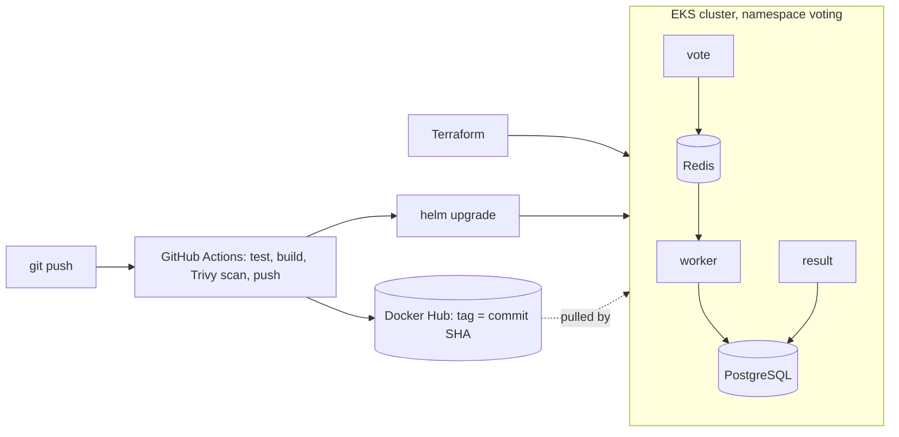

# Example Voting App — DevOps Capstone 1

## Overview

This project runs a Cats vs Dogs voting application. It includes a vote page, a results page, a worker that processes votes, Redis for vote messaging, and PostgreSQL for storing results.

The project demonstrates running the application locally with Docker Compose, creating an Amazon EKS cluster with Terraform, and using GitHub Actions to test, scan, publish, and deploy container images.

## Architecture



## Run locally

### Requirements

- Docker Desktop with Docker Compose
- Git

### Start the application

From the repository root, run:

```bash
docker compose up --build
```

The first build may take several minutes. Keep the terminal running while you use the app.

- Vote page: [http://localhost:8080](http://localhost:8080)
- Results page: [http://localhost:8081](http://localhost:8081)

Vote for Cats or Dogs, then open or refresh the results page.

To stop the application, press **Ctrl+C** in the terminal running Compose. Then run:

```bash
docker compose down
```

## Infrastructure (Terraform)

Terraform creates the EKS cluster, its IAM roles, and a managed node group in the AWS default VPC.

The project’s Terraform defaults were set to:

- Region: `eu-north-1`
- Cluster name: `vickysurest-capstone`
- Kubernetes version: `1.37`
- Worker instance type: `t3.small`
- Desired worker count: `3`

The GitHub deployer IAM user ARN is supplied locally through the ignored file `terraform/deployer.auto.tfvars`. Its contents should look like this, with the account ID replaced by the correct one:

```hcl
deployer_principal_arn = "arn:aws:iam::<account-id>:user/capstone-github-deployer"
```

The `.tfvars` file and Terraform state must not be committed.

To initialize and create the infrastructure, run these commands from the repository root:

```bash
cd terraform
terraform init
terraform fmt
terraform plan -out=tfplan
terraform apply tfplan
```

Configure `kubectl` to use the cluster and check the nodes:

```bash
aws eks update-kubeconfig --region eu-north-1 --name vickysurest-capstone
kubectl get nodes
```

The Terraform deployer access policy grants the GitHub Actions IAM user cluster-wide EKS administrator access for this capstone.

## CI/CD

The workflow is defined in `.github/workflows/ci-cd.yml`.

On pull requests and pushes to `main`, GitHub Actions:

1. Validates the Docker Compose configuration and checks the vote application’s Python syntax.
2. Builds the `vote`, `result`, and `worker` images.
3. Scans each image with Trivy. The scan fails the job for fixable critical findings.
4. On pushes to `main`, pushes images to Docker Hub with the commit SHA as the image tag.
5. On pushes to `main`, deploys that commit’s images to EKS using Helm.

Configure the following **repository variables** in GitHub under **Settings → Secrets and variables → Actions → Variables**:

- `DOCKERHUB_USERNAME`
- `AWS_REGION`
- `EKS_CLUSTER_NAME`

Configure the following **repository secrets** in the same area under **Secrets**:

- `DOCKERHUB_TOKEN`
- `AWS_ACCESS_KEY_ID`
- `AWS_SECRET_ACCESS_KEY`

Secret values are credentials; do not put them in this README, source files, or Git history.

The Docker Hub repositories are named `<DOCKERHUB_USERNAME>/voting-vote`, `<DOCKERHUB_USERNAME>/voting-result`, and `<DOCKERHUB_USERNAME>/voting-worker`. Each image is tagged with the commit SHA that built it.

## Deploy and rollback

### Deploy manually with Helm

Wait until the GitHub Actions build, scan, and push jobs succeed for the commit you want to deploy. From the repository root, run:

```bash
SHA=$(git rev-parse HEAD)
helm upgrade --install voting-app helm/voting-app \
  --namespace voting \
  --create-namespace \
  --set image.tag=$SHA \
  --wait \
  --timeout 5m
```

Check that all five application and data-service pods are running:

```bash
kubectl -n voting get pods
```

To access the app from your laptop, run each command in a separate terminal and leave both terminals open:

```bash
kubectl -n voting port-forward svc/vote 8080:8080
```

```bash
kubectl -n voting port-forward svc/result 8081:8080
```

Then visit:

- Vote page: [http://localhost:8080](http://localhost:8080)
- Results page: [http://localhost:8081](http://localhost:8081)

Stop a port-forward by pressing **Ctrl+C** in its terminal.

### Roll back a release

List the release history and identify the last known-good revision:

```bash
helm history voting-app -n voting
```

To demonstrate a failed release, deploy a tag that does not exist. This command is expected to fail after waiting:

```bash
helm upgrade voting-app helm/voting-app -n voting \
  --set image.tag=this-tag-does-not-exist \
  --wait \
  --timeout 90s
```

Inspect the pods and release history:

```bash
kubectl -n voting get pods
helm history voting-app -n voting
```

Roll back to the last known-good revision. Replace `<GOOD_REVISION>` with its revision number from the history:

```bash
helm rollback voting-app <GOOD_REVISION> -n voting --wait
```

Confirm that the pods are running again:

```bash
kubectl -n voting get pods
helm history voting-app -n voting
```

The GitHub Actions deploy job uses the same Helm chart and deploys automatically on pushes to `main`, after the image jobs succeed.

## Known trade-offs

- The PostgreSQL chart uses `emptyDir` storage. Database data, including vote totals, can be lost if the database pod is replaced.
- The database password is `postgres`, which is suitable only for this demonstration.
- The GitHub deployer has cluster-wide EKS administrator access. This is broader than a production deployment should require.
- GitHub Actions uses IAM access keys stored as repository secrets for this capstone. These are long-lived credentials; keep them private and remove or rotate them when they are no longer needed.
- The EKS cluster and its worker nodes may incur AWS charges while they exist.

## Clean-up

Remove the Helm release first:

```bash
helm uninstall voting-app -n voting
```

Then destroy the AWS infrastructure from the Terraform directory:

```bash
cd terraform
terraform destroy
```

Confirm the Terraform prompt to proceed. Destroying the infrastructure removes the EKS cluster and its managed resources.